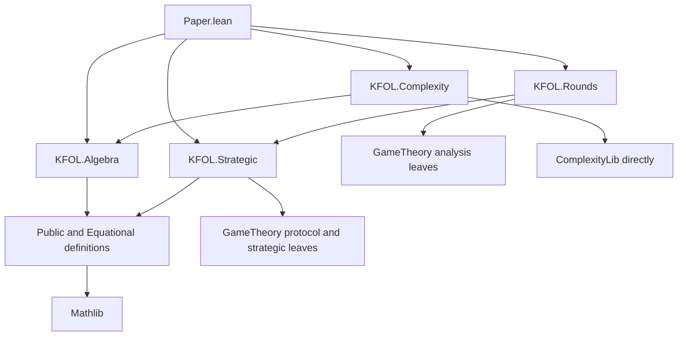

# KFOL formalization design and implementation plan

The target is a complete formalization of **the main paper `main.tex`, including its substantive prose claims, and the parts of the technical report needed for those claims**. Root `Paper.lean` repeats the complete main-paper propositions; a small collection of definition modules supplies an auditable meaning, and reusable proof modules supply the proofs. The entire technical report is not a completion target. This document records the design and milestone progress; completed claims and their exact verification evidence are recorded in the inventory.

The manuscript baseline is revision `6dff3f067151b9fc1cf9b9944718cf39a72d7447`. The existing 22 Std modules and the new mathlib algebra slice use Lean 4.35.0. `sections/appendix-verification.tex` is the starting evidence inventory. The existing proofs are valuable migration inputs, but a finite certificate, a specialized three-owner proof, and a generic theorem are distinct deliverables.

The [claim inventory](formalization-claims.json) distinguishes the **23 main-paper result environments**, **21 directly cited report result environments**, further proof dependencies, and optional report material. The earlier 140-result extraction is retained as a source catalog, not as the definition of done. Additional main-paper prose obligations are listed separately. Existing source evidence and the work still needed are separate fields. The [supporting-library assessment](formalization-libraries.md) records exact APIs, pins, assumptions and remaining bridges.

## Required scope and optional extensions

The required tier contains all 23 main-paper results, all 21 directly cited report results, their actual proof dependencies, and substantive main-paper prose claims. The inventory marks these roles separately; references to sections, verification evidence and open problems do not automatically promote entire appendices. In particular:

- The finite-family policy dichotomy is required: the main paper states it in prose. It cannot be deferred with the rest of the selective-policy appendix.
- The main round proposition includes observed mixed SPE equals serial SE. Keep that full clause as a required milestone, using GameTheory's existing SE foundation. A proof of the threshold games alone does not complete the proposition.
- The scoped main paper no longer asserts private-store connection. The entire semantic disclosure/connection branch and its syntactic metatheory are optional report work, not prerequisites for the closed-round protocol model.
- The main discussion's two-role and congruence assertions need their relevant proofs. Most unary forms, affine quotients, matching/fibers, conservative relative presentations, atomic bases, polynomial counts and residual-model results remain optional.
- Scalar real-QE decidability and general semialgebraicity are report-only and unused by the main claims. They are excluded without deleting or rewriting the report.
- The historical open-game sentence can use its pinned external proof artifact. Its entire convex-repair development need not be reimplemented in this package.

An intermediate milestone may certify semantic reductions, runtime bounds or the specific sealed games before the final imported complexity/SE bridge. Its status remains partial until the whole main claim is proved. Do not silently redefine “complete” to mean only the paper-specific half of a theorem.

## Manuscript scope decisions

The scope edit in `6dff3f0` removes the private-store connection claim and the reset/owner numerical free-algebra lists. Branch M and its typing, strategy, binding and sealing prerequisites are pruned from the required graph. Exact enumeration of those free-algebra lists is no longer a completion gate. Table recognition, synthesis, substitution, sharp input-domain sizes and minimum-generator cardinalities remain required.

The seven-equation choice/union basis was retained and moved to the basis section; its completeness proof remains required. The main text also retains scalar full abstraction, congruence classifications, the canonicalization consequence, and the two-player discussion. Their status remains unchanged. The finite-family policy dichotomy is a main result. No further editorial cut is assumed.

## Decisions after the integration gates

The current target includes full machine-level complexity theorems and the full SE clause of round recursion. The gates measure how to deliver that target; they do not automatically authorize weakening it.

- **Complexity gate:** certify one reset/union reduction end to end against the pinned 3SAT codec. Record effort separately for semantic correctness, encoding, reusable machine components, polynomial running time and class transport. Then inspect whether policy-family reductions and reset DAGs fit those components. “Roughly fifteen machines” is a planning hypothesis, not a verified count or fifteen necessarily independent implementations. Shared traversals, verifiers, owner instantiations and composition may reduce duplication. Leaving only the final class claim written would be an explicit change to the current definition of done.
- **Round gate:** compile a sealed two-bit round and establish its information sets, product beliefs and consistency using GameTheory. Include a two-round case with an unreachable public history, since an on-path single-round calculation does not test the off-path cancellation and pasting needed by the theorem. If a change of presentation is later chosen, define values by observed-action mixed SPE and move the serial-SE equivalence to the report. That changes the main definition and proposition and must be reviewed as a manuscript change; the current SE-based definition remains the target meanwhile.

## Architectural decisions

1. Use a Lake package, namespace `KFOL`, and the user's pinned GameTheory library with its matching mathlib version. The inspected GameTheory revision `c6650cd861d4a05a64adb2e4fd99a4feafa231b0` uses Lean/mathlib 4.35.0; KFOL now uses Lean/mathlib 4.35.0 for the completed first algebra slice, while the original baseline used Lean 4.34.1. Reuse its canonical PMFs, strategic definitions, Nash/minimax and SE foundations. The user intends GameTheory to update to the newer ComplexityLib; select that updated compatible dependency set at the strategic/complexity integration gate instead of fixing the previously inspected legacy ComplexityLib pin as the implementation target. Start the independent mathlib-only algebra slice meanwhile. Validate the selected imports in an isolated downstream workspace and retain the current build during migration.
2. Put every main-paper claim in root `Paper.lean`, including prose claims whose formal statements must be supplied from the report. Required report support lemmas normally remain in their natural library modules; export them in `Paper.lean` only when they express a main-paper assertion. Each theorem repeats its complete proposition, with its hypotheses and quantifiers. Its proof may invoke an implementation theorem. Neither `export`, an inferred theorem type, nor `theorem result : NamedClaim` is an acceptable public statement.
3. Concentrate the intended meaning in five `KFOL/Definitions/*.lean` modules, reusing imported semantic definitions through a small documented interface. Separate the algebraic public syntax from its strategic interpretation so algebra imports no GameTheory modules. Proof modules may introduce constructions and helper definitions, but every project-defined constant in a public theorem's type must be documented in the definition index, including transitive dependencies. Five files are an organizational target, not a reason to hide a large definition behind a short abbreviation.
4. Reuse mathlib's sets, permutations, algebraic languages, homomorphisms, substructures and quotients where they fit. Prototype native versus mathlib terms on pair-test transport and substitution/equational derivation before choosing the syntax. Both guard algorithms and generic algebraic proofs matter. Keep one semantic API after this gate. Generalize the small Equational Theories Project completeness proof where useful, with attribution; it currently treats one binary operation.
5. Keep the public-game algebra and closed-round equilibrium semantics separate, joined by explicit correspondence theorems. None is defined by the conclusion it is meant to certify.
6. Use category theory only in a named, separate portion that specifies objects, morphisms, equality, and laws. Ordinary homomorphisms and dependent equivalences suffice for the algebraic and execution proofs. The refuted mixed-open-game composition is an operation under study, never a `Category` instance.

The reusable library should not import `Paper`. `Paper` imports only completed result modules. Specialized certificates and tests import the library, rather than supplying mathematical assumptions to it.

## Import boundaries

GameTheory is a dependency of strategic interpretation, not of the winner-set algebra. Owned choice, reset, views, term evaluation, identities, bases, antimatroids, guards, and the nonfinite-basis proof can all be defined and proved using mathlib without importing GameTheory. Their strategic meaning is supplied afterward by adequacy theorems.

The intended dependencies, with arrows meaning “imports”, are:



`KFOL.Algebra` is an aggregate for the pure algebraic branches, including reset, owner/policy semantics and core bases; it is not a new copy of their definitions. These modules never import the strategic bridge, `Rounds`, the full `KFOL` umbrella, or `Paper`. Semantic guard proofs stay below the complexity-machine boundary. Import ComplexityLib directly for class and machine results; GameTheoryComplexity is a source of examples, not a necessary dependency of the algebra or complexity proofs.

`Definitions/Strategic.lean` compiles the shared public syntax to GameTheory and names its canonical profile, deviation and SPE specializations. A bridge proves that possible SPE winners equal the existing algebraic evaluator. The evaluator remains independent of equilibrium. Keep GameTheory names out of the pure theorem signatures as well as their imports; an unused theorem parameter or typeclass still couples the APIs.

Provide independently buildable module targets such as `lake build KFOL.Algebra`, `lake build KFOL.Strategic`, and `lake build Paper`. A CI import-graph check rejects any transitive dependency from the algebraic branches to `GameTheory`, `GameTheoryComplexity`, `FixedPointTheorems`, the KFOL strategic/round wrappers, or complexity-machine modules. Checking direct import lines alone is insufficient. This boundary is implemented for the pair-countervaluation and sharp-domain slice by `KFOL/Audit.lean` and `scripts/check_algebra.py`; later strategic and complexity branches have not been added.

In one Lake package, dependency resolution still fetches the packages declared by that package; Lean module imports control which definitions and proofs an algebra consumer loads and which modules its target needs built. A pinned toolchain is also package-wide. If algebra users must avoid even resolving/downloading GameTheory or must choose another compatible toolchain, split into an algebra package requiring only mathlib and a strategic companion requiring that package plus GameTheory. The same import layout supports that later split without rewriting the mathematics; the initial design does not require multiple packages.

## The claim audit surface

`Paper.lean` should have sections following the main paper, including its discussion-level mathematical assertions. Stable names follow the mathematics, with a docstring giving the exact LaTeX label and describing any difference in notation. Repeated statements in the two documents may share one public theorem if their strengths agree; the inventory maps both labels to that theorem. Split a multi-clause result into named components and provide the complete combined result as well.

For example, a pair-test theorem must quantify over both terms and every nonempty-set valuation, and conclude existence of a failing valuation whose inputs all have cardinality at most two. It must not merely restate correctness of a transformation on a previously supplied countervaluation. The backward-induction theorem includes equilibrium existence as well as the recurrence. The no-finite-basis theorem includes every fixed finite role set of size at least three and every variable bound, not only the displayed finite examples.

Use this pattern, with actual elaborated types rather than these schematic placeholders:

```text
/-- game:thm:adequacy. Every finite public game has a full pure SPE,
    and its possible equilibrium winners satisfy the owned-choice recurrence. -/
theorem KFOL.Paper.public_backward_induction
    [all required role hypotheses] (game : PublicGame Role) :
    (there exists a full profile satisfying the independently defined SPE predicate)
    and (the equilibrium winner set equals the recursively evaluated winner set) :=
  implementation proof
```

The final Lean file contains no placeholders. Attach a guarded `#print axioms` check to each paper theorem, as in `../VegasCore/Paper.lean`. Exact dependency lists can be empty or proper subsets of the allowed standard axioms; do not force every theorem to use all three.

The definition audit and the axiom audit answer different questions. A theorem with only standard axioms may still formalize the wrong game, the wrong basis notion, or the wrong information restriction. The definition index therefore records each public semantic constant, its source location, source-paper definition, and its project-defined dependencies. Generated dependency reports assist review; they do not establish correspondence with the prose.

For each required inventory row, implementation review records the public declaration, supporting theorem, all hypotheses, current evidence, and whether every clause is covered. Add separate obligations for prose assertions: polynomial bounds; the sharp test-domain and minimum-generator cardinalities; no Mal'cev or near-unanimity term; explicit nonconvexity; reset table substitution; two-role discussion claims; examples asserting a nonidentity; and external special cases actually used in the required proofs. The environment inventory is a starting list, not a claim that extraction alone finds all mathematics.

## Definition modules

| Module | Definitions that a reader must audit |
| --- | --- |
| `Definitions/Public.lean` | Nonempty winner sets, singleton and ambiguity, owned choice, reset and guarded/policy operations; signatures, public trees and terms, algebraic evaluation; occurrences, contexts, substitution and observations. Mathlib only |
| `Definitions/Equational.lean` | Finite-variable identities, satisfaction, theories, equational derivation, basis and variable bound; congruences and quotient interface; generated subalgebras; term operations and clones; native observer/atomic carriers; equational variety membership |
| `Definitions/Algorithms.lean` | KFOL encodings, tree/DAG representations and input length; specifications of guards, policy patterns and antimatroids. Mathlib only; the small audited `Complexity/Language.lean` facade adds the imported complexity classes and machine specifications separately |
| `Definitions/Strategic.lean` | Compilation of shared public syntax to GameTheory; canonical profile, execution, whole-player deviation, payoff and SPE specializations. The algebraic definitions never import this file |
| `Definitions/Rounds.lean` | Finite round syntax and FOSG/EFG compilation; winner payoff and imported Nash/SE specializations; equilibrium outcome sets, round operator and contextual observation/compositional semantics. Imported definitions and their transitive meaning are indexed explicitly |

These files do not mutually import each other. `Public` introduces algebraic signatures using the chosen term API. `Equational` imports `Public`; `Algorithms` adds mathematical algorithm specifications without game or machine imports. `Strategic` imports `Public` and narrow GameTheory leaves. `Rounds` uses that syntax and strategic interface plus the needed protocol/analysis leaves, not algorithm machinery. Cross-layer adequacy proofs live in bridge modules. Imported GameTheory and ComplexityLib definitions are part of the definition audit where used, not hidden behind local aliases or inherited by unrelated algebraic claims.

### Public values and syntax

Use `WinnerSet Role := {S : Set Role // S.Nonempty}` as the mathematical carrier. This removes repeatedly supplied nonemptiness hypotheses and keeps accidental empty-set valuations out of public statements. Finite executable sets form a separate representation with a proved equivalence for finite roles. Prove the operation-preservation bridge once. Existing predicate-set proofs can remain useful internally through this bridge.

Use `Equiv.Perm Role` for renaming, `Set` inclusion and disjointness, and ordinary `Nonempty`, `Finite`/`Fintype`, and cardinality APIs. General algebraic lemmas should use arbitrary role types and only the distinct-role hypotheses they need. Assume finiteness and cardinality at the boundary that needs them. Avoid a global `K ≥ 3` hypothesis; the two-role appendix should instantiate the same definitions.

The term API is selected by the prototype gate: either mathlib `FirstOrder.Language.Term` for relation-free signatures, or small signature-indexed native terms with a proved algebraic interpretation. Do not commit to a large syntax migration before measuring both uses. Specify separate core, constant, symmetric, reset, owner, and policy signatures, with maps/interpretations between them. Give ergonomic constructors and induction lemmas. Reset and union are derived terms in the core where appropriate; storing them as basic operations in a computational expansion requires a proved term-equivalence theorem. Parameterize an algebra by an explicit signature so unrelated operations cannot silently enter a proof.

Public ground games may use a small binary tree datatype to make occurrence-indexed strategies clear. Its equivalence to closed public terms is proved. Full profiles assign actions to every occurrence, including unreached occurrences. Restriction to a subtree is defined independently of the recursive winner evaluator. SPE quantifies over every subtree and every unilateral change to all of a player's decisions there. Distinguish occurrence paths from variable names: repeated variables denote independently solved copies. Uniform-copy strategies are a separate restriction with their own observation theorem.

### Equational semantics

An identity has an explicit finite arity and two terms on `Fin n`. Satisfaction universally quantifies over valuations. Theories may contain identities of unbounded arity. Define validity in a class of algebras and membership in the variety of a generator by satisfaction of all its identities. Prove closure under products, subalgebras, surjective homomorphisms, and isomorphism; use explicit HSP certificates to establish particular memberships.

Define equational derivation with hypotheses, reflexivity, symmetry, transitivity, operation congruence, and substitution. Prove soundness early. Prove the completeness theorem via the term-algebra congruence when a semantic basis proof needs to yield the paper's syntactic "follows in equational logic" conclusion. Do not identify semantic completeness with derivability by definition. Full Birkhoff representation need only be developed if a later proof uses its reverse direction.

An identity basis for a generator is a set of identities with exactly its equational consequences, over arbitrary nonempty algebras in the appropriate signature and carrier universes. Separate finite basis, bounded-variable basis, and conservative relative presentation. For variable bounds, count distinct free variables after renaming/support restriction, not the largest variable index or the arity of an artificially padded presentation. Prove finite families have a common finite variable bound. Include an explicit convention for nullary identities and the empty set of generators; it must not invalidate the zero-variable instance of a general theorem.

Use explicit bundled operation structures or locally scoped language instances for competing algebras on one carrier. Avoid global overlapping instances. Each owned operation is a semilattice operation, but their orders differ: do not install all of them as competing `SemilatticeSup` instances. A wrapper indexed by the owner can expose an order instance when needed.

### Algorithms and representations

Mathematical guard sets and minimal antichains are finite sets. Executable lists/bitsets carry proved invariants and denote those objects. Separate semantic completeness, checker correctness, algorithm termination, output-size bounds, and running-time bounds. Avoid claiming a polynomial algorithm solely because its number of guards is polynomial.

Use native tree input length for the main complexity claims and a topologically ordered DAG with node references for the circuit appendix. Prove encoding and decoding correctness and account for bit lengths of role labels, variables, permutations, and policy sets. Fixed-K and uniform-in-K claims are different theorems. Fixed-policy-family reductions may expand a constant-size derived operation; a family supplied as input needs a separate size analysis.

The polynomial/complete dichotomies must not assert that a coNP-complete case is outside P without P ≠ NP. Formalize the source's two branches as membership in P in the easy cases and coNP-completeness in the other cases. Define the complexity notions independently of these particular checkers. Import the matching pinned ComplexityLib machine-based cost model, polynomial verifier characterization, 3SAT completeness, and polynomial reduction composition. A reduction from 3UNSAT alone is an intermediate theorem, not the final coNP-completeness result. The inspected GameTheory complexity pins already supply machine-based classes, Cook–Levin, 3SAT completeness, complement duality and reduction composition; reuse them rather than starting this infrastructure project.

### Rounds and probability

Use GameTheory's ordinary mathlib `PMF Role` for semantic winner distributions and its `Math.Probability.Simplex` coordinate equivalence for finite-dimensional arguments. Keep probability generic over an ordered field for the reusable diagonal calculations; compactness and SE consistency specialize to ℝ. Prove adapters to any reused finite PMF interface instead of maintaining incompatible expectations.

A round has dependent finite nonempty action menus, one per role, and a continuation at every joint tuple. Ensure syntax is a finite tree: use a finite node presentation with a well-founded child relation or a bounded-height inductive presentation. An unrestricted W-type can accidentally permit well-founded trees without a uniform finite depth. Public histories determine menus and continuation nodes. No hidden state crosses a round boundary.

Compile round syntax to GameTheory execution/information models and use its independently defined behavioral strategies, deviations, sequential rationality and Kreps–Wilson consistency. Prove the translation agrees with the finite-game convention of the paper. The recursively generated outcome set is a second definition. The round theorem proves their equality. A predicate that already assumes stage Nash conditions is not an independent definition of SE.

Consistency must use one perturbation scheme for the whole finite game, handle zero-probability public histories, retain each player's own recall, and prove product beliefs at serial commitments. Every off-path continuation is selected. The serial order and release steps are explicit; prove they have the observations described by the paper. Separate strategic randomization from chance and from shared random seeds.


## Proposed proof modules and coverage

The following packages cover the required main-paper areas. The source catalog also lists optional report results; their presence does not make them deliverables. Each package includes the necessary unnumbered main-paper consequences.

| Package | Modules below `KFOL/` | Paper and report obligations | Existing starting points |
| --- | --- | --- | --- |
| A | `Public/Strategy`, `Public/BackwardInduction`, `Public/Occurrences` | SPE existence and recurrence, finite action folds, union/ground realization, no Boolean representation; preserve independent repeated occurrences | `Basic`, `Synthesis`; occurrence lower bounds and uniform-repetition classifications are optional |
| B | `Algebra/Perspectives`, `Algebra/TestDomains`, `Algebra/Status` | Contextual player quotient and faithful subdirect family; reduct and full test sufficiency/necessity and exact minima; status provenance | `Perspectives`, `Synthesis`, `FullAlgebra` |
| C | `Algebra/Intrinsic`, `Algebra/CommonSource`, `Algebra/AtomicClone` | Exact idempotent syntax, effective extraction, semilattice trace and intrinsic views; common source including the occurrence clause; atomic clone, determinacy, no if-then-else and no special core terms | `Separation`, `FullAlgebra`, `OneConstant`; clone theorem needs a formal proof/import |
| D | `Reset/Tables`, `Reset/Antimatroid`, `Reset/Basis` | Binary atom-preserving classification, reset compilation and chain completeness, six-law derivational completeness, table realization/recognition/substitution, antimatroid bijection  | `Reset`, `OneConstant`; complete the required normal forms and external special cases |
| E | `Owner/Guards`, `Owner/Synthesis`, `Owner/Basis` | Root laws, observer implication/equality and one-table checker, minimum four-element generator, realizable tables/synthesis bound, forty-law completeness and four-variable lower bound | `OwnerFragments`, `OwnerModels`; exclude conservative relative presentations and residual theory except any lemma actually used |
| F | `Policy/Guards`, `Policy/Patterns`, `Policy/Classification` | Selective operations and strictness, chain/nested and overlapping policies, calibrated observers, two-policy classification, arbitrary finite-family pattern criterion and separators | `ChainGuards`, `MixedPolicies`; classification, normalization and reductions need assembly |
| G | `Complexity/Encoding`, `Complexity/CheckerBounds`, `Complexity/Reductions`, `Complexity/Circuits` | Every tree-fragment and observer dichotomy, fixed/uniform complexity, coloring identities and theory strictness, DAG reset completeness, algorithmic extraction/recognition/synthesis bounds elsewhere | `BooleanCore`, `Fragments`, `RawFragments`, guard checkers; full reductions and complexity foundations remain |
| H | `Algebra/Congruences`, `Algebra/Observation` | Unique-winner observation, reduct congruence classification and symmetric ambiguity-threshold chain as asserted in the main paper | Most unary/affine/matching/fiber classifications in the report are optional |
| I | `Core/Native`, `Core/LocalTheory`, `Core/Grid`, `Core/NonfiniteBasis` | Native memberships, typed upper-clone cover, protected paths/private padding, arbitrary-generator local cover, finite countermodels at every variable bound and no finite basis for every K ≥ 3 | `CoreObstruction` is a starting certificate; the uniform theorem is new. Ambient-native nonfinite basability is optional |
| J | `Core/ChoiceUnion` | Seven-equation choice/union basis claimed in the complexity section, plus structural lemmas needed by package I | `CoreModels`; binary counts, polynomial forms, conservative presentations and atomic basis/lifting are optional |
| K | `Rounds/Encoding`, `Rounds/Recursion` | Observed mixed SPE equals serial SE, complete recursion, public support conservativity, exact nonconvex/nonidempotent example | Reuse GameTheory SE/Nash/minimax, serializer and one-shot foundations. General compactness/semialgebraicity results are optional |
| L | `Rounds/Scalar`, `Rounds/Threshold`, `Rounds/Contextual` | Scalar stage values, diagonal formula, rational synthesis needed for thresholds/full abstraction, concrete threshold games, exact winner formula and no finite compositional observation | `SealedRounds` arithmetic plus new syntax/SE bridges. General scalar equation decidability is optional |
| N | `TwoPlayers/Algebra`, `TwoPlayers/Rounds` | Main discussion: Kleene tables, reachable atoms/forcing, finite basis, projection/union degeneracies, failure of the three-role idempotent characterization and winner support of rounds | Reuse common primitives and GameTheory minimax. Full two-player term-function and complexity classifications are optional |
| O | Separate historical proof target | Check the pinned historical unit/associativity failure theorems supporting the main related-work sentence | Existing v1-final artifact; no rewrite/port of all convex-repair results required |

Keep proof files at the size of a coherent argument. Splitting a proof into files does not justify defining a second version of winner sets, syntax, validity, or deviation.

## Critical proofs and their interfaces

### Core nonfinite basability

Build this against the generic equational layer rather than expanding the three-owner certificate.

1. Construct native `D_R`, the atomic quotient, the observer maps, their surjectivity and all proper-owner memberships for arbitrary finite roles. Prove derived union agrees with native join.
2. Prove profiles compute atomic outputs, their monotonicity, and common-source intersection. Make protected paths a reusable lemma with explicit incidence premises.
3. Define a rigid upper clone and reflecting element for an arbitrary model. Prove the typed-cover lemma by constructing the generated subalgebra and its surjective homomorphism, including the "below e with upper marker implies e" invariant.
4. Define finite padded rectangle coordinates and native source columns. Prove finiteness without enumerating closure. Prove the three protected-path arguments, the exact three-element old ideal, reflection, and the failed coverage identity. Expand derived union to actual core syntax and prove the stated variable count.
5. Quantify over arbitrary elements of the source algebra as coefficient generators. Prove the duplicate row/column profile lemma using the `2^m` bound. The locality theorem must not assume coefficients are source columns. Construct the exact atomic typing relation and the required core cover.
6. Treat subalgebras with and without the new upper point separately. Obtain every d-variable identity by generated-subalgebra transfer. Handle d = 0 independently if needed; for positive d the paper uses rectangles larger than `2^(d-1)`.
7. Conclude failure of every bounded-variable basis using soundness; derive failure of finite bases using the maximum variable support of a finite family. The ambient native corollary may be added as an optional consequence; it is not a required separate theorem.

The public result includes the finite countermodel for each d, satisfaction of *every* d-variable native-valid identity, and a native-valid identity it fails. Finite rectangle checks are regression data, never substitutes for Steps 4–5.

### One-owner finite basis

Represent the forty identities as an explicit finite family of terms, not forty opaque predicates. Prove their count and variable bound after expansion of the derived actions. Transfer soundness from the four-element generator using its full theory equivalence. Formalize common-root projection, semilattice decomposition, unary action words, normalization/contraction, guard capture and two-source absorption. Convert mutual guard coverage into an explicit derivation. This supplies completeness over arbitrary algebras and in equational logic. The lower bound uses the countermodel satisfying every three-variable identity, rather than a bounded term search. Keep the conservative 17/13-law relative presentation separate.

### Round correspondence and infinite index

First prove the extensive-form semantic theorem, including whole-continuation deviations and a globally consistent perturbation. Then connect the algebraic diagonal certificates to actual two-bit syntax. Prove the recursively constructed games have their asserted unique distribution for every index, and that the public probes have exactly the displayed three winner sets. Only then instantiate the arithmetic separation lemma.

Define a compositional observation semantics by an interpretation into a carrier with constructor operations and an observation map. Its contextual congruence follows from substitution. The no-finite-summary theorem quantifies over every such finite carrier preserving the third player's possible win. Supply the context-preservation induction, including repeated independent hole occurrences. Scalar full abstraction uses equality of complete distribution sets in one direction and syntactically realized rational thresholds in the other.


## Category theory portion

No category theory is necessary to state the principal algebraic results. If categorical packaging is useful, add `KFOL/Category/Algebra.lean` for bundled relation-free algebras with homomorphisms; verify the standard laws there and reuse that portion explicitly.

The separate historical target has an explicitly indexed definition surface for the refuted operation. Read it with the obstruction statements. It must not import any alleged category instance for that operation. Follow README and `sections/appendix-open-games.tex`: the refutation is scoped to the published composition and specified convex repairs, not all mixed games. Never modify `../GameTheory`. Use the immutable historical artifact and its lock in an isolated proof target. Port minimal definitions only if that proves necessary for a single-toolchain public audit; do not make a full historical port an initial deliverable.

## External mathematics and completion risks

External mathematical inputs actually used by a main-paper proof need a kernel proof in the relevant dependency closure for its unconditional theorem. References to related work are not an instruction to formalize all cited literature. A temporary theorem parameter for an external fact is acceptable as an explicitly conditional intermediate result, but does not complete the corresponding inventory row. Do not add axioms for published theorems.

| Input | Used for | Required route |
| --- | --- | --- |
| Classification of the repeat-triple polymorphism clone | Atomic clone and determinacy, then binary classification | Import a verified theorem after checking its exact finite-domain hypotheses, or formalize the needed finite combinatorial classification locally |
| Freese et al. order-algebra results | Reset basis completeness and minimum generators | Prove the needed special cases via normal forms/explicit models where practical; otherwise formalize the cited theorem and its hypotheses |
| Antimatroid/dependency representation | Exact representation, realizability, recognition, substitution and stated counts | Formalize finite set systems and both constructions/inverses; prove both directions and the compact-table algorithms rather than adding a name for the citation |
| Dissemilattice generation | Seven-equation fragment claimed in the main paper | Formalize the precise generation theorem or replace its use by an explicit separating representation proof |
| Kleene presentation | Two-role finite basis cited in the main discussion | Verify/import the exact theorem, or give a direct normal-form/term proof for the needed case |
| Mixed Nash existence, finite SE existence and zero-sum value uniqueness | Required round semantics | Reuse the inspected GameTheory Nash, SE existence and minimax interfaces; prove the KFOL finiteness, recall, nonempty-menu, integrability and payoff-shift premises |
| Polynomial computation theory and 3SAT completeness | All main-paper coNP-completeness conclusions | Use the inspected pinned ComplexityLib machine, Cook–Levin, 3SAT and coNP transport theorems; prove the new encodings, algorithms and reduction machines |

The remaining substantial work is the generic nonfinite-basis proof, six-law/forty-law completeness, special-case clone and generation results, concrete machine bounds, and the paper-specific round bridges. General complexity theory, Nash/SE definitions and existence are reused, while real QE and general syntactic dependent metatheory are outside the target. Estimate delivery after the narrow integration prototypes, rather than extrapolating from the original 140-row catalog.

The mathlib APIs checked for this design include [relation-free language structures and homomorphisms](https://leanprover-community.github.io/mathlib4_docs/Mathlib/ModelTheory/Basic.html), [substructures and generated closure](https://leanprover-community.github.io/mathlib4_docs/Mathlib/ModelTheory/Substructures.html), and [finite simplexes](https://leanprover-community.github.io/mathlib4_docs/Mathlib/Analysis/Convex/StdSimplex.html). These support the proposed reuse; their presence does not establish availability of the larger external theorems above. Public documentation can move; implementations must use the pinned source.

## Migration of the existing Lean development

Start by filling the statement-level existing-evidence map and checking the unchanged baseline. Add a Lake target for the legacy modules or a temporary import path preserving their names. Port in small batches with temporary bridges: predicate sets to `WinnerSet`, `RolePerm` to `Equiv.Perm`, native term datatypes to signature terms, and specialized finite models to bundled algebras. Prove evaluation and substitution commute with each bridge. Preserve old proofs until their public replacement and bridge pass the same build.

Prioritize `Basic → Perspectives → Synthesis → Separation → FullAlgebra`, followed by `Reset`, owner/policy modules, and native core certificates. `CoreQuotients` and `CoreMixed` may provide useful proof ideas; do not migrate them solely to preserve optional report certificates. `SealedRounds` remains a local scalar-certificate module until the extensive-form bridge is complete.

Retire duplicate definitions and compatibility aliases after consumers migrate. Avoid an enduring `Legacy` semantics imported by `Paper`. Do not copy speculative candidate-basis explorations into the new library: only revive them if a maintained argument requires them. Historical searches and superseded results remain in git history.

## Implementation sequence and completion gates

The sequence is dependency-based. Some branches can proceed independently once the shared definitions stabilize; it does not require agent delegation.

### First delivery milestone completed

The independently buildable **pair-countervaluation slice** is complete on Lean/mathlib v4.35.0. It uses mathlib only and did not wait for GameTheory's ComplexityLib update. The native term representation was retained after the checked comparison in `tests/SyntaxComparison.lean`; see [the syntax decision](formalization-syntax.md) and [definition index](formalization-definitions.md). The list below records the completed delivery contract.

1. Reconcile `sym:thm:pairs` and its supporting existing Lean declarations against the exact paper statement. Record which definitions and helper lemmas the slice actually needs; leave unrelated migration work alone.
2. Establish the minimal public algebraic interface: nonempty winner sets, owned choice, role permutations, full term syntax and evaluation. Keep profiles, SPE and every GameTheory import outside this interface.
3. Compare native and mathlib term representations on this slice and a small substitution/equational-congruence example. Choose using theorem readability, executable traversal and actual proof overhead; retain one implementation afterward. Do not build the full generic HSP/completeness framework to run this comparison.
4. Port the existing pair-countervaluation argument. Root `Paper.lean` explicitly states that any failed equation has a failing valuation assigning one or two winners to every input, with all hypotheses and quantifiers visible. The proof may invoke the library theorem; the statement cannot delegate to a named claim predicate.
5. Pass a clean algebra target and `Paper` build, guarded axiom checks, and a transitive import check excluding GameTheory, GameTheoryComplexity and complexity-machine imports. Supply a short definition index for this theorem's type and record the completed statement in the inventory.

The milestone is complete when that main-paper theorem is checked end to end on the chosen auditable algebraic definitions. It does not require the rest of `Paper.lean`, a new mathematical result, or a GameTheory bridge. It validates the syntax, dependency boundary and paper-facing audit format with an existing substantial proof. The same interface now also proves sharp test domains (see below). The algebraic idempotent extension is recorded below; perform the public-SPE and round integration gates when the updated GameTheory dependency set is ready.

### Sharp test domains completed

Root `KFOL.Paper.optimal_test_domain` repeats the entire `sym:thm:optimal`
claim: the characterization at every finite arity, leastness under inclusion,
and the exact `K(K+1)/2` count. Necessity uses genuine unary terms isolating each
singleton and pair, built from the original syntax through a derived union
and ground-set synthesis. The cardinality is proved by a bijection with
mathlib's symmetric square, not a finite sample. The reusable testing predicate
is indexed in `Definitions/TestDomains.lean`; the root theorem spells it out.
Only this characterization requires finite roles and three distinct roles.
The shared definitions and pair theorem keep their original generality.

### Idempotent algebra and checked extraction completed

`KFOL.Paper.idempotent_elimination` now states the exact occurrence criterion,
equivalence with expressibility in the core and semantics-preserving extraction
at all valuations, with no increase in constructor count. The core is a
predicate on the existing terms, not a new syntax/evaluator. Input occurrences
record their accumulated permutations independently of the extraction.
`KFOL.Paper.checked_core_extraction` additionally proves that the finite-role
`extractCore?` program succeeds exactly for idempotent terms, and every success
returns a core with equal semantics and bounded output size.

This completes the algebraic and functional clauses of `gen:thm:core`. That
inventory row remains partial: a constructor-count bound is not a polynomial
machine-time proof for encoded permutations. The existing complexity milestone
must supply that remaining clause. Regression cases check noncommuting
permutation order, cancellation across a choice node, actual program reduction,
and the two-role counterexample to the no-winner characterization. The
independent `check_core.py` also checks 1200 decorated/arbitrary terms.

### Player views and semilattice trace completed

`KFOL.Paper.player_views` proves the exact contextual classification for unary
polynomials with arbitrary finite parameter lists, and the K+1 count of the
actual quotient. `KFOL.Paper.public_subdirect_representation` proves the
injective homomorphism, coordinate surjectivity and both carrier/factor counts.
`KFOL.Paper.intrinsic_player_views` extends the homomorphism to all idempotent
full-language operations and proves irredundance. The concrete view states and
representatives are in `Definitions/Views.lean`; all are independent of
contextual equivalence and of the homomorphism claims they certify.

`KFOL.Paper.semilattice_trace` includes the full `gen:cor:trace` statement.
Its clone portion uses explicit finite-arity support laws: nonempty support,
exact classification of restricted operations, realization of every nonempty
support, projections and composition by union. Substitution preserves
idempotency and agrees with semantic composition. No generic clone or category
framework is needed for these laws. The theorem also proves essentiality of
all core arguments, regularity of identities and absence of near-unanimity and
Mal'cev terms in the full language. All these clauses are kernel checked.

Tests guard three abstraction boundaries: switches need not preserve player
views, subdirect representations need not fill the product, and equal supports
determine operations only on ambiguous inputs. Two-role and nullary cases are
also checked. GameTheory remains absent from this dependency closure.

### Common sources and atomic consequences completed

`KFOL.Paper.common_source` now covers all of `gen:thm:source`. It selects one
actual leaf and accumulated permutation satisfying the entire disjoint family
of constraints. With two distinct indices that same witness is an input, and
its membership in the existing input-occurrence list is included. The new
`sourceOccurrences` enumeration retains the original labels, traversal order
and duplicate leaves. A proved bridge connects it to `inputOccurrences`.
The proof needs neither finite types nor three roles and handles empty or
infinite index families. It depends on elementary algebra and the shared syntax,
not on idempotent elimination.

The immediate prose claims are also complete:
`KFOL.Paper.atomic_repeated_triples` proves preservation of the repeat-triple
relation whenever the relevant outputs are atomic, and
`KFOL.Paper.no_atomic_if_then_else` excludes a selector for any two distinct
control labels. They use common-source separation directly; the external S2
classification remains a separate required input. Boundary tests cover overlap,
permuted source values, the single-region winner case and an empty index type.
An independent check enumerates actual leaf paths in 210 finite term cases.

Next complete the reduct test-domain count and diagonal idempotency certificates.
The separate complexity milestone still owes the polynomial-time clause of
idempotent extraction. Strategic integration remains a separate gate after the
dependency update.

| Milestone | Prerequisites | Concrete completion gate |
| --- | --- | --- |
| 0. First algebra delivery completed | This plan | Lean/mathlib v4.35.0; native syntax selected; `KFOL.Paper.pair_countervaluations` in root `Paper.lean`; definition index; clean builds and compiled axiom/import checks |
| 1. Shared public and equational foundation | 0 | Extend the validated algebraic interface to validity and derivation, HSP preservation, generated-subalgebra transfer and finite-variable-bound lemma; keep strategic profiles in their separate branch |
| 2. Public paper backbone A–C | 1 | Complete public statements for recurrence/existence, views/tests, idempotent syntax and common source; remaining clone dependency is explicitly tracked, with no conditional result marked complete |
| 3. Reset and owner D–E | 1–2 | Algorithms with semantics, synthesis and exact finite generators; six-law and forty-law completeness plus lower bounds, not just soundness |
| 4. Policy and complexity F–G | 1, algorithm specs, relevant milestone 3 results | Verified reductions and representation-sensitive bounds; all fixed/uniform dichotomy clauses including observation-relative cases |
| 5. Required algebra H, J, N | 1–3 and needed external special cases | Main-paper congruences, seven-law basis and two-role discussion claims; no general report-only classification backlog |
| 6. Uniform core nonfinite basis I | 1–2, native membership | Arbitrary-K typed covers, arbitrary-generator locality and full finite-countermodel theorem for every variable bound; core conclusion |
| 7. Round semantics K | 1, GameTheory integration gates | Existing independent SE specialized to round syntax; product-belief/pasting proof, observed/serial equality and full recursive equation |
| 8. Scalar and contextual rounds L | 7, local certificates | Concrete syntax-to-rate bridge, full threshold winner formula, no finite compositional observation and full abstraction; no real-QE dependency |
| 9. Historical obstruction O | Pinned-source review | Immutable external proof target checks the unit/associativity failures actually asserted in the main text |
| 10. Final claim reconciliation | All preceding obligations | Every main-paper claim has complete `Paper.lean` statement(s), reviewed definition closure, matching scope and standard-axiom audit; clean reproducible full build |

Finish each milestone with a small reviewable set of completed public theorems. Do not create a future `Paper.lean` full of admitted stubs: keep incomplete targets in the inventory and add declarations when proofs are available. Root `Paper.lean` may grow as coverage grows; it must accurately describe the coverage of its current revision.

## Verification and maintenance

The planned CI gates are:

- A clean pinned `lake build KFOL Paper` with warnings as errors, plus the library tests and current independent Python checks.
- An independent `lake build KFOL.Algebra` and a transitive import-graph check enforcing the algebra/strategy/complexity boundaries above.
- A declaration audit rejecting `sorryAx`, project axioms and unexpected axiom dependencies throughout the paper closure. Only `propext`, `Classical.choice`, and `Quot.sound` are allowed where actually used. Restricting checks to a text search for `sorry` is insufficient.
- A definition/dependency report for all public theorem types, and a coverage check from the inventory to actual elaborated declarations. Compare hypotheses and individual clauses in review; an existence check on theorem names is insufficient.
- Kernel-checked finite certificates. Prefer `decide`/proof-producing checking for bounded data; do not base paper results on `native_decide`, unchecked external solver output, or Python assertions. Large search artifacts should have a proved checker and a kernel proof of acceptance; the search is outside the trusted proof path.
- Exact finite counts justified by exhaustive enumeration with proved completeness, or by a generic bijection/counting proof. A JSON table with a matching number of rows does not prove exhaustion. If an exhaustive search is itself a claimed proof, certify both coverage of candidates and correctness of every certificate.
- A few cross-representation checks with mathematical purpose: three distinct roles, the two-role case, unreached SPE decisions, independently repeated variables, zero diagonal entries, off-path round tuples, and off-path round histories. Once their meaningful gates pass, avoid redundant tests that merely restate definitions.

Keep proof evidence in the verification appendix. Do not modify mathematical prose or the 15-page main paper merely to narrate progress. If formalization discovers a changed theorem or missing hypothesis, repair the relevant argument and surrounding text in the appropriate document. Any renumbering requires `make paper` and committing both label snapshots according to `AGENTS.md`. This plan itself changes no LaTeX numbering.

Completion means every main-paper mathematical assertion is proved with its stated generality, including necessary report support. Report-only results remain optional and do not block completion. Conjectures, open questions, and related-work attributions are classified as such rather than counted as unproved new theorems. An unresolved imported theorem, a conditional theorem replacing an unconditional statement, or an unconnected semantic certificate remains unfinished work.
